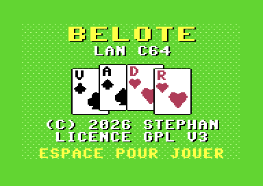
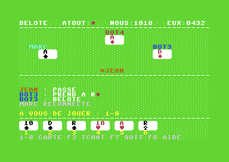
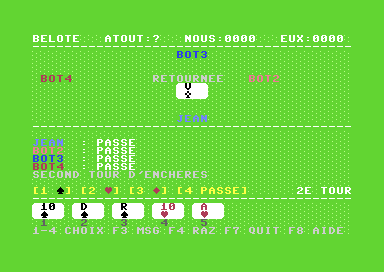

# BELOTE LAN C64

Belote en réseau local pour **Commodore 64 Ultimate**. Jusqu'à quatre joueurs humains, chacun sur
son C64. Les places libres sont tenues par des bots. Un serveur Python sur le PC arbitre la partie.



| Table de jeu | Enchères, second tour |
|---|---|
|  |  |

## Ce qu'il y a dedans

- **Client C64** (`c64/`, C avec cc65) : l'écran est en mode couleur étendue (ECM), avec des cartes
  rouges et noires sur un tapis de feutre vert. Le réseau passe par la
  *Ultimate Command Interface* ($DF1C-$DF1F). Un écran titre en bitmap multicolore est généré par
  `tools/titre.py`.
- **Serveur** (`server/`, Python 3.13 asyncio) : il applique les règles de la belote classique, gère
  les bots, la reconnexion, l'inactivité et le tchat.
- **Protocole** : texte ASCII, une ligne par message terminée par LF (64 octets au maximum), sur le
  port TCP 6464. On peut jouer ou déboguer avec `nc` (voir [protocol.md](protocol.md)).
- **Spécification complète** (règles, protocole, écran) : [SPEC.md](SPEC.md).

## Démarrer

Il faut un C64 Ultimate (ou un Ultimate 64 / Ultimate-II+) avec l'API REST et la Command Interface
activées, cc65, Python 3.13 et, en option, VICE.

### 1. Régler les adresses : `config.mk`

Ouvrez `config.mk` et mettez les adresses de votre réseau :

| Variable | Rôle | Défaut |
|---|---|---|
| `SERVEUR_IP` | IP du PC qui fait tourner le serveur ; pré-remplie sur le C64 | `192.168.1.55` |
| `SERVEUR_PORT` | Port TCP du serveur, côté PC et côté C64 | `6464` |
| `ULTIMATE` | IP du C64 Ultimate, pour envoyer le programme (`make deploy`) | `192.168.1.27` |

L'IP du PC s'obtient avec `ip addr` (Linux) ou `ipconfig` (Windows). Celle de l'Ultimate se lit dans les
réglages réseau de son menu. Chaque valeur peut aussi être donnée ponctuellement sur
la ligne de commande, sans modifier le fichier : `make deploy ULTIMATE=192.168.0.64`.

### 2. Lancer

```sh
make server    # serveur sur SERVEUR_PORT (crée le venv au besoin)
make deploy    # tests, compilation, envoi et lancement sur l'Ultimate
```

Sur le C64 : une touche passe l'écran titre. Le champ SERVEUR contient déjà `SERVEUR_IP:SERVEUR_PORT`
et reste modifiable (RETURN pour passer au nom). Entrez ensuite un nom de 5 caractères. Le premier
arrivé devient le chef. Pour les autres C64, il suffit d'envoyer le même programme
(`make deploy ULTIMATE=<ip de l'autre C64>`) ou de le copier sur leur carte.

Le port doit être ouvert sur le PC, par exemple
`sudo ufw allow from 192.168.1.0/24 to any port 6464 proto tcp`.

Pour que le serveur démarre tout seul avec le PC, installez-le en service systemd : voir
[docs/serveur-service.md](docs/serveur-service.md).

## Touches

| Touche | Action |
|---|---|
| 1-4 | Enchères : prendre (à la couleur retournée au 1er tour, à une autre au 2e) ou passer |
| 1-8 | Jouer la carte affichée sous ce numéro |
| F1 | Chef, en attente : réglages (points pour gagner, délai d'inactivité) |
| F2 | Chef : lancer la partie |
| F3 | Tchat (30 caractères) |
| F4 | Chef : effacer la partie en cours (confirmation par O) |
| F5 | Chef : manche suivante, ou nouvelle partie |
| F7 | Quitter la table (un bot prend la place) |
| F8 | Règles du jeu |

## Développement

```sh
make                         # build/belote_lan.prg
make test                    # tests du serveur (pytest)
make vice                    # écran de connexion dans VICE (VICE n'émule pas la Command Interface)
make vice-demo SCENARIO=1..5 # client avec un réseau simulé, pour voir les écrans de jeu
python3 tools/titre.py       # régénère l'écran titre (Pillow)
```

Dans le terminal du serveur, `RAZ` efface la partie en cours. Les particularités de l'Ultimate
constatées sur le matériel (sockets libérés, Command Interface bloquée) sont notées dans
[CLAUDE.md](CLAUDE.md).

## Auteurs

Stéphan ([@Stephan83c](https://github.com/Stephan83c)), avec l'aide de Claude (Anthropic).

## Licence

Copyright (C) 2026 Stéphan (@Stephan83c).

Logiciel libre sous licence **GNU GPL version 3 ou ultérieure** : voir [LICENSE](LICENSE).
Vous pouvez l'utiliser, l'étudier, le modifier et le redistribuer. Toute version modifiée que vous
distribuez doit rester sous GPL, avec son code source.
