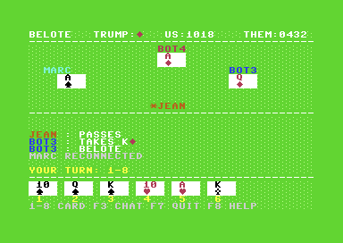
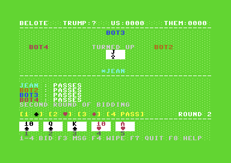

# BELOTE LAN C64

*English · [Français](README.fr.md)*

Networked belote for the **Commodore 64 Ultimate**. Up to four human players, each on their own
C64. Empty seats are taken by bots. A Python server on the PC referees the game.

Belote is the classic French trick-taking card game: 32 cards, two teams of two, trumps chosen by
bidding on a turned-up card. The rules are built in (F8 shows them on the C64).


| Game table | Bidding, second round |
|---|---|
|  |  |

## What's inside

- **C64 client** (`c64/`, C with cc65): the screen uses extended colour mode (ECM), with white
  cards (rank and suit in red or black) on green felt. Networking goes through the *Ultimate
  Command Interface* ($DF1C-$DF1F). A multicolour bitmap title screen is generated by
  `tools/titre.py`. Music on the title screen and sound effects in game (card played, trick, chat,
  win, loss) play on the SID; they are written in `tools/musique.py`. Four languages (French,
  English, German, Spanish), chosen with F1 on the connection screen; the texts live in
  `tools/textes.py`.
- **Server** (`server/`, Python 3.13 asyncio): enforces the rules of classic belote and handles
  bots, reconnection, idle players and chat.
- **Protocol**: ASCII text, one message per line ending in LF (64 bytes at most), on TCP port 6464.
  You can play or debug with `nc` (see [protocol.md](protocol.md)). Protocol keywords are French
  (JOIN, ENCH, COUP, PASSE...); the client translates what it displays.
- **Full specification** (rules, protocol, screen): [SPEC.md](SPEC.md).

## Play right away

Download **`belote_lan.prg`** from the [Releases](https://github.com/Stephan83c/belote-lan-c64/releases).
By default it connects to the public server `51.38.50.79:6464` (the address can be changed on the
connection screen). You need a C64 Ultimate (or Ultimate 64 / Ultimate-II+) with the **Command
Interface** enabled in its settings, on a network with Internet access.

To start it:

- copy the file to the Ultimate's USB stick or SD card, then run it from its file menu;
- or send it from a PC on the same network, if the Ultimate's REST API is enabled:
  `curl -X POST --data-binary @belote_lan.prg http://<ultimate-ip>/v1/runners:run_prg`.

Press a key on the title screen, then **F1** on the connection screen to pick your language.

## Getting started

You need a C64 Ultimate (or an Ultimate 64 / Ultimate-II+) with the REST API and the Command
Interface enabled, cc65, Python 3 (written and tested with 3.13, standard library only) and,
optionally, VICE. The server alone (for example on a VPS) only needs Python, git and make.

### 1. Set the addresses: `config.mk`

Open `config.mk` and enter your network addresses:

| Variable | Purpose | Default |
|---|---|---|
| `SERVEUR_IP` | Server IP (or host name), pre-filled on the C64 | `51.38.50.79` |
| `SERVEUR_PORT` | Server TCP port, on both the PC and the C64 | `6464` |
| `ULTIMATE` | IP of the C64 Ultimate, to send the program (`make deploy`) | `192.168.1.27` |

Get the PC's IP with `ip addr` (Linux) or `ipconfig` (Windows). The Ultimate's IP is shown in the
network settings of its menu. Any value can also be given once on the command line, without
editing the file: `make deploy ULTIMATE=192.168.0.64`.

### 2. Run

```sh
make server    # server on SERVEUR_PORT (creates the venv if needed)
make deploy    # tests, build, send and run on the Ultimate
```

On the C64: any key leaves the title screen. The SERVER field already holds
`SERVEUR_IP:SERVEUR_PORT` and can be edited (RETURN moves to the name). Then enter a name of up to
5 characters. The first player in becomes the host. For the other C64s, just send them the same
program (`make deploy ULTIMATE=<other C64 ip>`) or copy it to their card.

The port must be open on the PC, for example
`sudo ufw allow from 192.168.1.0/24 to any port 6464 proto tcp`.

To have the server start with the PC, install it as a systemd service: see
[docs/server-service.md](docs/server-service.md).

## Keys

| Key | Action |
|---|---|
| 1-4 | Bidding: take (the turned-up suit in round 1, another suit in round 2) or pass |
| 1-8 | Play the card shown above this number |
| F1 | Connection screen: change language |
| F1 | Host, while waiting: settings (points to win, idle timeout) |
| F2 | Host: start the game |
| F3 | Chat (30 characters) |
| F4 | Host: wipe the game in progress (confirm with Y; O, J or S in the other languages) |
| F5 | Host: next round, or new game |
| F7 | Leave the table (a bot takes the seat) |
| F8 | Game rules |

## Development

```sh
make                         # build/belote_lan.prg
make test                    # server tests (pytest)
make vice                    # connection screen in VICE (VICE does not emulate the Command Interface)
make vice-demo SCENARIO=1..6 # client with a simulated network (6: listen to the sounds)
python3 tools/titre.py       # regenerates the title screen (Pillow)
python3 tools/musique.py     # regenerates the music and sound effects
python3 tools/textes.py      # regenerates the texts in the 4 languages (checks their widths)
make LANGUE=1                # language at startup: 0 FR, 1 EN, 2 DE, 3 ES
```

To add or fix a translation, edit `tools/textes.py` and run it: it refuses any text too wide for
its place on screen, or any character the C64 cannot show in ECM (everything is upper case,
without accents).

In the server's terminal, `RAZ` wipes the game in progress. Quirks of the Ultimate found on real
hardware (released sockets, stuck Command Interface) are noted in [CLAUDE.md](CLAUDE.md) (French).

The source code, its comments and the project notes are in French.

## Authors

Stéphan ([@Stephan83c](https://github.com/Stephan83c)), with help from Claude (Anthropic).

## License

Copyright (C) 2026 Stéphan (@Stephan83c).

Free software under the **GNU GPL version 3 or later**: see [LICENSE](LICENSE).
You may use, study, modify and redistribute it. Any modified version you distribute must remain
under the GPL, with its source code.
